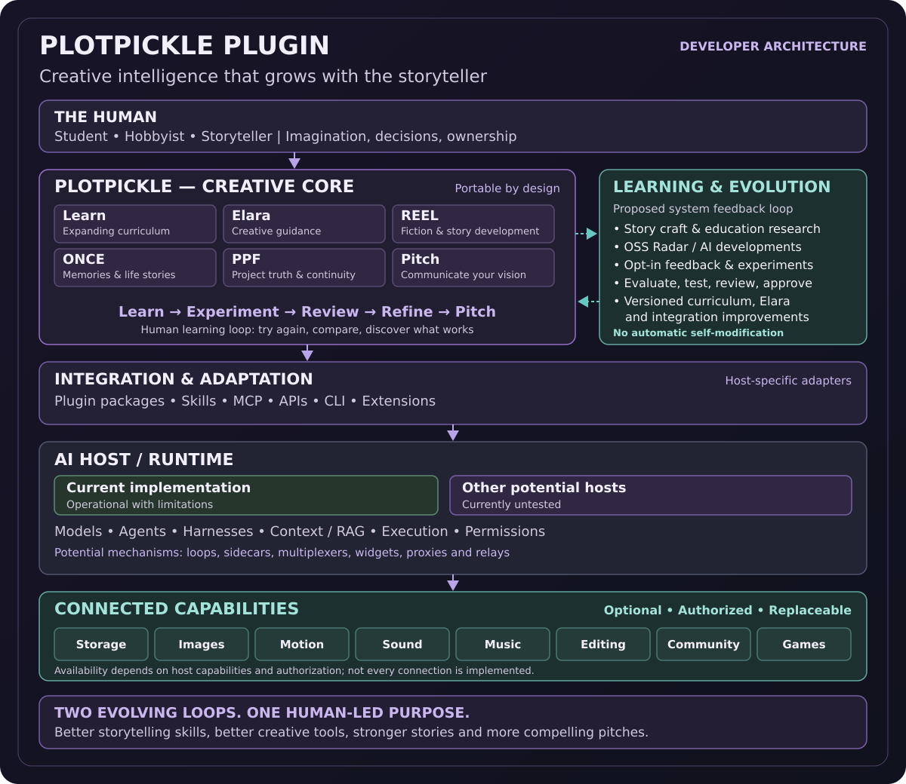

# PlotPickle Studio

<p align="center">
  
</p>

**Your story. Your decisions. Your cut.**

**Open-source ChatGPT plugin — available for community testing**

PlotPickle Studio is an open-source project available for personal installation and community testing through ChatGPT’s **Plugins → Personal** area. This repository provides published source code, documentation and downloadable releases. Public marketplace distribution is not required. Published material is governed by its applicable licence.

PlotPickle Studio is a storytelling learning and creative development plugin for students, hobbyists and independent storytellers. Work with Elara, your creative collaborator, to learn the craft, experiment visually through trial and error, and develop a better story.

The goal is not to produce a perfect movie. It is to help you explore what works, refine your creative vision and build a compelling pitch package for a book, comic book, short story, feature-length film or episodic series.

**[Website](https://plotpickle.com)** · [Studio](https://plotpickle.com/home) · [Downloads](https://github.com/BryanHarrisScripts/PlotPickle-Studio/releases)

- **Learn** — explore an expanding library of storytelling and creative development lessons.
- **Experiment** — visualize ideas, characters, worlds and scenes; compare alternatives through trial and error.
- **Develop** — refine narrative, structure, dialogue, pacing and visual continuity with Elara.
- **Pitch** — assemble written, illustrated or cinematic materials that communicate your story and creative vision.

<p align="center">
  
</p>

## A system that grows with you

Choose **REEL** to develop a fictional story or **ONCE** to explore personal memories and life stories. Both encourage learning by doing. The curriculum and Elara's creative guidance can expand as storytelling techniques, research and AI capabilities evolve.

## Surface sitemap

```text
PLOTPICKLE STUDIO — in this ChatGPT conversation
├── HOME — Skin V2, five cards in this order
│   ├── 1. MEET ELARA — creative collaboration in chat
│   ├── 2. LEARN — 12 topics → 81 lessons
│   ├── 3. STORYBOARD
│   │   ├── REEL — film / screenplay route
│   │   └── ONCE — personal story route
│   ├── 4. LIBRARY / YOUR STORIES
│   │   ├── Signed-in Studio project catalogue
│   │   └── Select source files in chat or import PPF/WebP from HOME
│   └── 5. CONNECTED SERVICES
│       ├── PlotPickle Studio
│       └── ChatGPT Space
└── DIRECT STUDIO ENTRY POINTS
    ├── STORY MAP — 4 Acts → 12 Sequences → 24 Blocks → 96 Mini-Blocks
    ├── SHOT GRID — 25 planning positions per Mini-Block
    ├── REVIEW / EDITOR — shot review and six-track timeline
    │   └── PITCH EDIT — timeline workflow
    └── SYSTEM RECORDS — account-private Studio records inventory
```

## Developer architecture

PlotPickle separates its creative core from the infrastructure that runs it. The aim is portability through host-specific integrations, not dependence on a particular model or platform. The current implementation has limitations; other potential hosts remain untested.

The architecture includes two complementary feedback loops: the creator learns through visual experimentation, while PlotPickle can improve through reviewed research, open-source discovery (OSS Radar), optional feedback and tested releases. System improvements are proposals until reviewed and approved; private stories are not automatically collected for training or used to change the system.

<p align="center">
  
</p>

## Install in ChatGPT

1. Sign in to [ChatGPT](https://chatgpt.com/) with the account you want to use.
2. Open **Plugins → Personal**. Under **Created by you**, select **PlotPickle Studio** if it is already listed.
3. Select **Install plugin** or the **+** button if shown. If prompted to connect to Studio, review the permissions and follow the ChatGPT sign-in prompts.
4. Start a conversation, type `@PlotPickle Studio`, select the plugin, and ask **Open Studio HOME**.

### Set up from a ZIP

**Current release: [PlotPickle Studio v2.0.59](https://github.com/BryanHarrisScripts/PlotPickle-Studio/releases/tag/v2.0.59)** — published November 27, 2026 (Toronto time), with direct Studio MCP, ChatGPT OAuth, and updated Save → Lock workflow.

1. Open the release page above and download the plugin ZIP from **Assets** (not GitHub's automatically generated source-code ZIP).
2. Compare the ZIP's SHA-256 checksum with the checksum supplied with the release.
3. In ChatGPT, open **Plugins → Add** and select **Plugin Creator**, if available. Install it if prompted.
4. Attach the downloaded ZIP in a Plugin Creator conversation and ask it to create PlotPickle Studio as a personal plugin.
5. Open **Plugins → Personal**, select PlotPickle Studio and install it. Review and authorize the Studio connection if prompted.
6. Start a conversation, select `@PlotPickle Studio` and ask **Open Studio HOME**.

The v2.0.57 and v2.0.58 releases are superseded by v2.0.59. The archived v2.0.55 ZIP uses a retired Studio connection and should not be used for new installations. For future updates, check [GitHub Releases](https://github.com/BryanHarrisScripts/PlotPickle-Studio/releases/latest).

The v2.0.59 release includes a plugin ZIP and SHA-256 checksum. Connected Services lists PlotPickle Studio and ChatGPT Space; optional providers are managed through their own ChatGPT plugins. Save → Lock is designed to verify the exact PPF and original image in the private Studio working copy. Release notes report passing automated checks; signed-in production acceptance remains pending. Setup depends on account permissions and access to the Studio connection.

[OpenAI’s plugin installation and setup instructions](https://help.openai.com/en/articles/20001256-plugins-in-chatgpt)

For release packaging and verification, see [RELEASES.md](RELEASES.md).

## Licensing

**[Open Technology](docs/licensing/OPEN-TECHNOLOGY.md)** — MIT-licensed designated software may be used, modified and redistributed for personal or commercial purposes, subject to preserving the copyright and licence notices.

**[Shared Creativity](docs/licensing/SHARED-CREATIVITY.md)** — designated creative and educational works are licensed under CC BY-NC-SA 4.0: sharing and adaptation are permitted for noncommercial purposes with attribution and the same licence for adaptations.

The licence supplied with each published file or release governs that material. User stories remain under their creators’ chosen terms.

**The human remains the author.**
