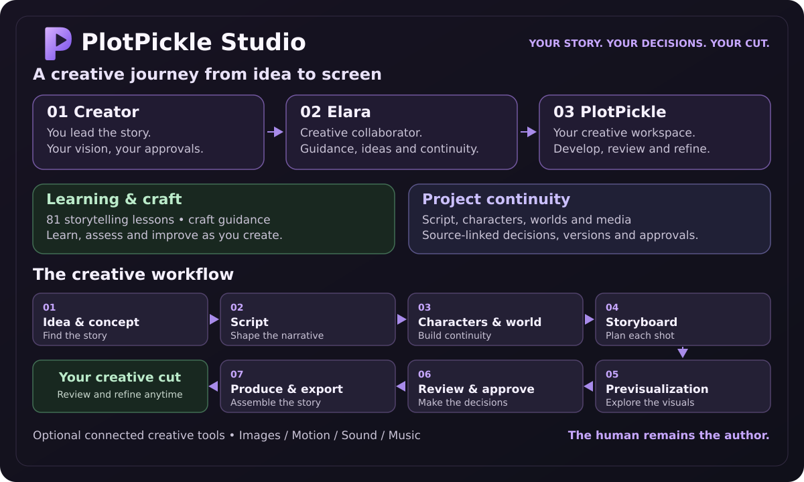

# PlotPickle Studio

**Your story. Your decisions. Your cut.**

PlotPickle Studio is a storytelling learning and creative development plugin for students, hobbyists and independent storytellers. Work with Elara, your creative collaborator, to learn the craft, experiment visually through trial and error, and develop a better story.

The goal is not to produce a perfect movie. It is to help you explore what works, refine your creative vision and build a compelling pitch package for a book, comic book, short story, feature-length film or episodic series.

**[Website](https://plotpickle.com)** · [Studio](https://studio.plotpickle.com/home) · [Downloads](https://github.com/BryanHarrisScripts/PlotPickle-Studio/releases)

- **Learn** — explore an expanding library of storytelling and creative development lessons.
- **Experiment** — visualize ideas, characters, worlds and scenes; compare alternatives through trial and error.
- **Develop** — refine narrative, structure, dialogue, pacing and visual continuity with Elara.
- **Pitch** — assemble written, illustrated or cinematic materials that communicate your story and creative vision.

  

## A system that grows with you

Choose **REEL** to develop a fictional story or **ONCE** to explore personal memories and life stories. Both encourage learning by doing. The curriculum and Elara's creative guidance can expand as storytelling techniques, research and AI capabilities evolve.

## Developer architecture

PlotPickle separates its creative core from the infrastructure that runs it. The aim is portability through host-specific integrations, not dependence on a particular model or platform. The current implementation has limitations; other potential hosts remain untested.

The architecture includes two complementary feedback loops: the creator learns through visual experimentation, while PlotPickle can improve through reviewed research, open-source discovery (OSS Radar), optional feedback and tested releases. System improvements are proposals until reviewed and approved; private stories are not automatically collected for training or used to change the system.

  

## Install

Developed for ChatGPT. When a verified plugin ZIP is available under [Downloads](https://github.com/BryanHarrisScripts/PlotPickle-Studio/releases), download it and use the native plugin upload option where supported by your account. Connect any required services, select PlotPickle Studio and say **Home**.

Adaptations to other AI platforms are welcome, but have not been tested.

## Contribute

Ideas, improvements and independent adaptations are welcome. See [Contributing](CONTRIBUTING.md).

## Licensing

**[Open Technology](docs/licensing/OPEN-TECHNOLOGY.md)** — MIT for designated software.

**[Shared Creativity](docs/licensing/SHARED-CREATIVITY.md)** — CC BY-NC-SA 4.0 for designated creative and educational works.

These are our licensing direction for new releases. The applicable licence is identified with each release or work. User stories remain under their creators’ chosen terms.

**The human remains the author.**
